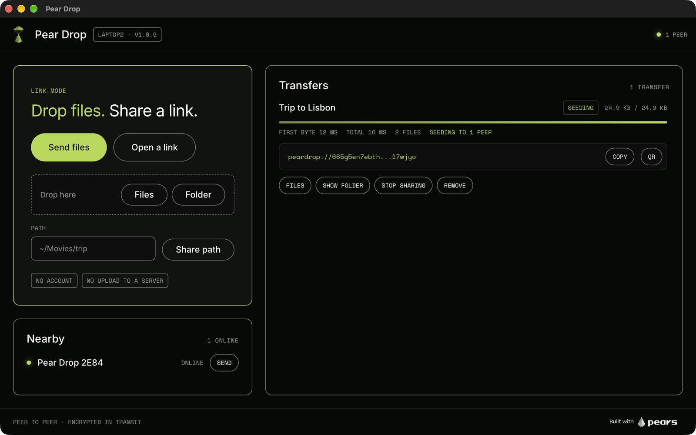

# Pear Drop

<picture>
  <source media="(prefers-color-scheme: dark)" srcset="docs/built-with-pears-light.svg">
  
</picture>

Send files and folders straight from one computer to another. No account, no upload, no server in between.
Pear Drop is AirDrop and WeTransfer in one desktop app: it works next to you and across the internet,
and it updates itself over the same peer-to-peer network, with no app store and no update server.



## What it does

- **Send**: drop files or a folder, get a `peardrop://` link and a QR code.
- **Receive**: paste the link, the files come straight from the sender's computer.
- **Nearby**: devices behind the same internet connection (same public IP) show up in a list, one click to send.
- **Resume**: a transfer that stops (app closed, network change) picks up where it stopped.
- **Over-the-air updates**: the developer publishes a new version from their laptop, every installed copy
  downloads only the changed blocks and offers "New version ready · Restart".

## How it works

| Step | What happens | Built on |
| --- | --- | --- |
| Share | The files become a Hyperdrive, a peer-to-peer file system. Its public key is the link. | [Hyperdrive](https://github.com/holepunchto/hyperdrive), [Corestore](https://github.com/holepunchto/corestore) |
| Find | Both apps join a topic derived from the key on a distributed hash table, find each other, and punch through NATs to connect directly. | [Hyperswarm](https://github.com/holepunchto/hyperswarm), [HyperDHT](https://github.com/holepunchto/hyperdht) |
| Transfer | Blocks stream over an end-to-end encrypted connection (Noise) and are checked against a Merkle tree, so nothing can be swapped in transit. | [Hypercore](https://github.com/holepunchto/hypercore) |
| Update | The app itself is staged to a `pear://` link. Each copy watches that link and pulls the new version peer to peer. | [Pear](https://docs.pears.com), [pear-runtime](https://github.com/holepunchto/pear-runtime) |

The Electron window is only the interface. The peer-to-peer engine runs in a [Bare](https://github.com/holepunchto/bare)
worker (`workers/pear-drop.mjs`) that serves the UI on `127.0.0.1`, and the Pear updater runs in a second worker
(`workers/main.js`).

## Run it

Requirements: macOS on Apple silicon (the build scripts are tested there), Node.js 22 or later (tested on 25), Xcode command line tools.

```bash
npm run install:mac
npm start
```

`npm start` runs without updates. Two instances on one machine need their own port, name and storage:

```bash
npx electron-forge start -- --no-updates --name Laptop2 --port 3142 --storage /tmp/pear-drop-2
```

| Flag | Default | Meaning |
| --- | --- | --- |
| `--name` | `Pear Drop XXXX` (random, kept per install) | Name shown to other devices in Nearby |
| `--port` | `3140` | Local port of the interface |
| `--storage` | app data folder (a temp folder when run with `npm start`) | Where the app keeps its data |
| `--no-updates` | off | Do not check the `pear://` link for new versions |

## Ship your own updates

You need the [Pear CLI](https://docs.pears.com) (`npm i -g pear`).

1. Create your own app link once: `pear touch`, then put it in `package.json` under `upgrade`.
2. Ship: `npm run ship` packages the app, runs `pear build` and `pear stage` on your link.
3. Keep it reachable: `bash scripts/ship.sh seed` in a terminal you leave open (or any always-on machine).
4. Install on another Mac: `mkdir -p ~/PearDropApp && npx pear-install <your pear:// link> --to ~/PearDropApp`.

Every later `npm run ship` reaches all installed copies over the network, and each copy downloads only the blocks that changed.

## Project layout

```
electron/        window, Pear updater wiring, worker launch
workers/         Bare workers: Pear updater (main.js) and the Pear Drop engine (pear-drop.mjs)
pear-drop/       engine (server.mjs) and interface (public/, with bundled fonts)
renderer/        fallback page shown if the engine does not start
scripts/         ship.sh
build/           icons and signing entitlements
docs/            README images
forge.config.js  Electron Forge packaging (macOS, Windows, Linux makers)
```

## Privacy and security

- A link is a read capability: anyone who has it can download what it points to while a peer is seeding.
  Use **Stop sharing** to close it.
- Data travels encrypted between peers and is never stored on a third-party server. The interface loads nothing from the internet (fonts are bundled).
- Nearby shows a device name to devices behind the same public IP. By default it is a random `Pear Drop XXXX`, never your computer name. Set your own with `--name`.
- Received files are marked as downloaded from the internet (macOS quarantine), so Gatekeeper checks any app before it first runs.

## Credits

Pear Drop started from [hello-pear-electron](https://github.com/holepunchto/hello-pear-electron) by Holepunch
(see [NOTICE](NOTICE)) and runs on the [Pear](https://pears.com) stack.

## License

[Apache-2.0](LICENSE)
